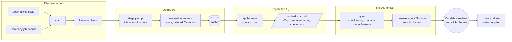

# career-ops-dk

**An AI job-search pipeline for Denmark that finds the roles other tools miss and fills application forms, then stops so a human clicks Submit.**

## Product case study at a glance

| | |
|---|---|
| **Problem** | Most Danish product roles are only on Jobindex.dk, which the open-source career-ops system does not scan. And filling the same application forms again and again is slow, while auto-apply tools submit for you and guess answers they do not know |
| **User** | A job seeker in Denmark targeting product roles, running the search with an AI agent |
| **Key decision** | [Nothing submits an application](product/decision-log.md#d4-nothing-in-the-system-submits-an-application). The agent fills the form; a human reviews and clicks Submit. Enforced in code, not just in a prompt |
| **Evidence** | One scan: Jobindex found **13** Danish product roles against **2** from ten company boards. Form filling measured at about **$0.26** per application |
| **Agentic AI** | Four AI agents, each given only the freedom its mistakes can afford, from a read-only triage prompt to a browser agent fenced off from submitting. [How it works](#3-agentic-ai-design-how-much-freedom-each-agent-gets) |
| **Trust by design** | Facts are copied from the profile and never written by a model; unknown questions stop the run; every file is checksummed and the cover letter must name the right company |
| **Next** | Block submission at network level, record diversity answers once, and track interviews per application |

📄 **Product docs:** [One-page brief](product/brief.md) · [Success metrics](product/metrics.md) · [Roadmap](product/roadmap.md) · [Decision log](product/decision-log.md)

The product story comes first below. The [architecture diagram](#4-architecture) is in the Product section; setup is in [For engineers](#for-engineers).

---

# Product

## 1. Problem and user

Two gaps made an AI-run job search in Denmark worse than it needed to be.

**Discovery missed most Danish roles.** career-ops scans company job boards. In one scan, the ten configured boards returned 2 Danish product roles; Jobindex.dk returned 13, including the enterprise and public-sector tier (banks, regions, KOMBIT) that no company board reached.

**Applying was slow, and the fast options were unsafe.** Auto-apply tools submit on the candidate's behalf and guess what they do not know, including work authorisation and salary. An application cannot be recalled, and a cover letter sent to the wrong employer reads as careless.

**Target user:** a job seeker in Denmark, targeting product roles, who runs their search with an AI agent and wants fewer hours on forms without losing control of what is sent.

**Job to be done:** *"When a role fits me, prepare the application and fill the form with my real details, so I only review and click Submit."*

**Deliberately out of scope:** submitting, guessing answers, storing personal data in the repo, forking career-ops. ([brief](product/brief.md))

## 2. Key product decisions

| Decision | Why | Trade-off |
|---|---|---|
| **A human always clicks Submit** ([D4](product/decision-log.md#d4-nothing-in-the-system-submits-an-application)) | The value is removing typing, not judgement. A missing action cannot be used; a rule in a prompt can be ignored | The candidate reviews every form |
| **Facts are copied, never generated; unknowns stop the run** ([D7](product/decision-log.md#d7-facts-are-copied-never-written-by-a-model-unknowns-stop-the-run)) | If a model writes the facts, fabrication has only moved one step earlier | More runs stop early until the profile is complete |
| **The wrong file can never reach an employer** ([D6](product/decision-log.md#d6-guard-against-a-file-reaching-the-wrong-employer)) | Checksums prove a file is intact; the company-name check proves it is the right one | A cover letter that never names the company needs a manual fix |
| **Cheap triage before paid evaluation** ([D9](product/decision-log.md#d9-a-cheap-triage-before-paid-evaluation)) | Most scan results are clearly off-target and cost almost nothing to rule out | A good role with an unusual title can be skipped |
| **The score bar is typed each run** ([D8](product/decision-log.md#d8-the-score-bar-is-typed-each-run-not-configured-once)) | Widening the net should be a conscious choice, not a forgotten setting | One more argument to type |
| **An overlay, not a fork** ([D1](product/decision-log.md#d1-an-overlay-on-career-ops-not-a-fork)) | Upstream updates keep working with no merge work | Two repos to keep in step |

## 3. Agentic AI design: how much freedom each agent gets

The pipeline uses AI agents at four points, and each one gets only as much freedom as its mistakes can afford. Anything that can be done by plain code (scanning, liveness checks, exporting bundles, checksums, the facts file) is not given to a model at all.

| Stage | Who acts | Autonomy | Guardrails |
|---|---|---|---|
| **Conversation** | The candidate's agent CLI (e.g. Claude Code), inside the career-ops checkout | Works with the candidate, turn by turn | Reads [AGENT-NOTES.md](AGENT-NOTES.md) only when the question needs it, through a short pointer in `modes/_custom.md`, so the full rules are not carried in context all day |
| **Triage** | One cheap prompt | Read three named files, write one file, nothing else | May not open URLs, fetch ads or start other agents. Posting text is treated as untrusted data. Unknown facts go to "maybe" with the reason, never a guess |
| **Evaluation** | Parallel headless workers (upstream career-ops) | High: run unattended | The one deliberate exception ([D14](product/decision-log.md#d14-accept-the-upstream-batch-runners-permission-bypass-deliberately)): the upstream runner skips permission checks. Accepted and documented; narrowing it is on the roadmap |
| **Form filling** | A browser agent (browser-use, Claude Sonnet) | Acts on a live website, inside a fenced action space | Running JavaScript and file actions removed (except uploading the CV); the click action replaced by one that refuses submit buttons in English and Danish; navigation limited to the posting's own hosts; answers only from the bundle; stops on unknown questions and captchas; picks options by visible text, never position |
| **Submit** | The candidate | Full | The only step that cannot be undone stays with a human |

Three principles run through it:

- **Constrain the action space, not just the prompt.** A rule in a prompt can be ignored; an action the agent does not have cannot be used. That is why submit is blocked in code ([D4](product/decision-log.md#d4-nothing-in-the-system-submits-an-application)).
- **Stopping is a valid outcome.** An agent that stops and records the question word for word is more useful than one that guesses on a legal declaration ([D7](product/decision-log.md#d7-facts-are-copied-never-written-by-a-model-unknowns-stop-the-run)).
- **Treat the internet as untrusted input.** Job postings are written by third parties and can contain text that looks like instructions. Every prompt says so, and nothing in a posting can widen what an agent may read or write.

## 4. Architecture



career-ops itself is cloned unchanged; this repo installs the Danish provider and the automation into it, and the browser runner reads only the exported folders.

## 5. What changed along the way

- **The first design was wrong and was deleted.** A per-form field-map contract invented a feature career-ops does not have. It was replaced the same day by one self-contained folder per role ([D5](product/decision-log.md#d5-a-self-contained-folder-per-role-as-the-interface)).
- **Symlinks failed silently.** The scan quietly lost its Jobindex provider and the bridge reported 0 pending roles. Reverted to copies within the day ([D2](product/decision-log.md#d2-install-copies-not-symlinks)).
- **Measured before building.** A read-only smoke test against a real posting set the cost per form before the queue and runner were built ([D13](product/decision-log.md#d13-measure-before-building)).

## 6. How success is measured

North star: **interviews per application submitted**, not applications per week. Guardrails that must stay at zero: submissions without a human click, guessed answers, files sent to the wrong employer, duplicate applications. ([metrics](product/metrics.md))

## 7. What is next

Block the submit request at network level, record diversity answers once in the profile, narrow what evaluation workers can touch, and log interview outcomes. ([roadmap](product/roadmap.md))

---

# For engineers

The Denmark-specific half of a career-ops job search, plus the browser runner
that fills application forms. Two halves that career-ops upstream does not ship.

```
career-ops-dk/
  bootstrap.sh    START HERE — sets up everything on a fresh machine
  QUICKSTART.md   how to actually use it once installed
  AGENT-NOTES.md  what these additions are (read by agents, and by you)
  overlay/        code that installs INTO a career-ops checkout
  apply-runner/   the Python/browser-use form filler (standalone)
  setup.sh        installs the overlay into a checkout
```

### The three moving parts

| Part | Where it comes from | How it updates |
|------|--------------------|----------------|
| career-ops | `git clone https://github.com/career-ops-hq/career-ops.git` | `node update-system.mjs apply --confirm` |
| this overlay | this repo | `./setup.sh` |
| browser-use | a uv dependency of `apply-runner` | `uv sync` |

career-ops is cloned unmodified. Nothing here is a fork of it, so upstream
updates keep working: `update-system.mjs` fetches a **hardcoded** canonical URL,
not your `origin`, so this checkout's remote can point anywhere. The only hard
requirement is that the checkout owns its own `.git` — a ZIP copy is refused.

### What the overlay contains

- **`providers/jobindex.mjs`** — Jobindex.dk, Denmark's largest job board, via
  the public RSS feed. This is the single highest-value file here: one scan
  returned 13 DK product roles against 2 from all ten configured company boards,
  and it is the only thing that reaches the enterprise/public-sector tier
  (Danske Bank, Jyske Bank, Region Syddanmark, KOMBIT). Drop-in — the registry
  globs `providers/*.mjs`, so nothing needs registering.
- **`automation/`** — `run-chain.sh` (the whole chain in one command) and
  `pipeline-to-batch.mjs`, which closes a real upstream gap: nothing shipped
  converts `data/pipeline.md` into `batch/batch-input.tsv`.

### Setup on a new machine

```bash
git clone <this repo> career-ops-dk
cd career-ops-dk
./bootstrap.sh
```

That is the whole install. It checks what you are missing, clones career-ops,
installs the overlay, fetches the browser, sets up the Python runner, creates
your `.env`, runs the test suites, and prints the three things left to do. It
never uses sudo and re-running it is safe.

You need first: **git**, **Node 18+**, **uv** (`curl -LsSf https://astral.sh/uv/install.sh | sh`),
and an agent CLI such as Claude Code. bootstrap tells you which are missing and
how to get them, then stops rather than half-installing.

You also need an **Anthropic API key** from console.anthropic.com for the form
filler. It bills per token, separately from any Claude subscription — measured
at about **$0.26 per application**. career-ops itself runs on your agent CLI's
own subscription, not this key.

Check an existing install at any time:

```bash
./bootstrap.sh --check      # verifies everything, changes nothing
```

### Working on the overlay

`overlay/` is the source of truth. Edit there, then `./setup.sh` to install.

```bash
./setup.sh --check   # has the installed copy drifted from overlay/?
./setup.sh --pull    # rescue edits made directly in the checkout
```

#### Why copies and not symlinks

Tried on 2026-09-13, reverted the same day. Both halves break under a symlink,
and both break *silently*:

- `providers/jobindex.mjs` imports `./_html-entities.mjs`. Node resolves a
  symlinked module's imports against its **realpath**, so the import looked
  inside `overlay/providers/` and the provider failed to load. `scan.mjs`
  carried on with 87 providers instead of 88 and reported no error.
- `automation/*.mjs` compute `ROOT` as `dirname(import.meta.url)/..`, which via
  a symlink is `overlay/`, not the checkout. `pipeline-to-batch.mjs` reported
  `0 pending` against a `data/pipeline.md` holding real URLs.

Copies keep every file's realpath inside the checkout. `--check` is what
replaces the guarantee symlinks would have given.

### Your data

**This repo contains no personal data, and nothing you generate should be added
to it.** Clone it, install the overlay, then run career-ops' own onboarding: it
creates `cv.md`, `config/profile.yml`, `modes/_profile.md` and `portals.yml` in
your career-ops checkout, all of which career-ops already gitignores.

Everything your search produces — the tracker, reports, generated CVs, scan
history, interview prep — stays in that checkout, on your machine. `userdata/`
and `handoff/` are gitignored here so a stray backup can never be committed.

The consequence worth knowing: there is no offsite copy. If the machine dies,
the search history goes with it. Back the career-ops checkout up however you
back up anything else you would not want to retype.

`apply-runner/.env` is gitignored too. The Anthropic key never travels; each
machine needs its own.

#### Never commit these

- `apply-runner/.env` — the Anthropic API key.
- `cv.md`, `config/profile.yml`, `data/`, `reports/`, `output/` — your own
  job-search state. career-ops gitignores all of it; keep it that way.
- `data/contacts.tsv`, `data/Connections.csv` — recruiters and LinkedIn
  connections. That is *other people's* personal data, and it does not belong in
  a repo even a private one.

## License

MIT, see [LICENSE](LICENSE). career-ops itself is a separate project under its own license; this repo does not include or modify it.
